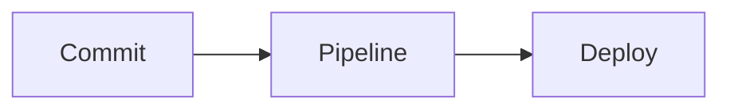

# Aula 09 - Documentacao de Software

Coloque nesta pasta o material oficial da aula (slides em PDF).

## Resumo tecnico

Documentacao e parte do produto. Codigo sem documentacao depende de quem escreveu para ser entendido, instalado e mantido.

## Tipos de documentacao

| Tipo | Publico | Exemplo |
|---|---|---|
| README | Quem chega ao repositorio | O que e, como rodar, como testar |
| Requisitos | Time e cliente | Funcionalidades e regras de negocio |
| Arquitetura | Desenvolvedores | Camadas, componentes, diagramas |
| Referencia de API | Quem consome o sistema | Rotas, parametros, respostas |
| Operacao | Quem faz deploy e suporte | Variaveis de ambiente, deploy, monitoramento |
| Changelog | Todos | O que mudou em cada versao |

## Documentacao como codigo (docs as code)

- Escrita em Markdown, dentro do repositorio, junto com o codigo.
- Versionada no Git: a documentacao de cada versao fica junto da versao.
- Revisada em pull request, como qualquer alteracao.
- Validada pela pipeline (links, formato, estrutura).
- Diagramas em texto com Mermaid, renderizados direto pelo GitHub.

## Mermaid em uma linha

````

````
