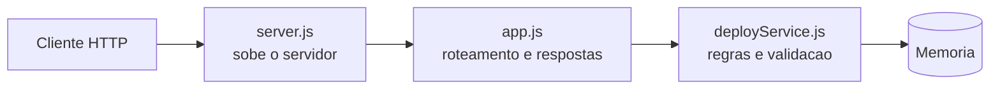
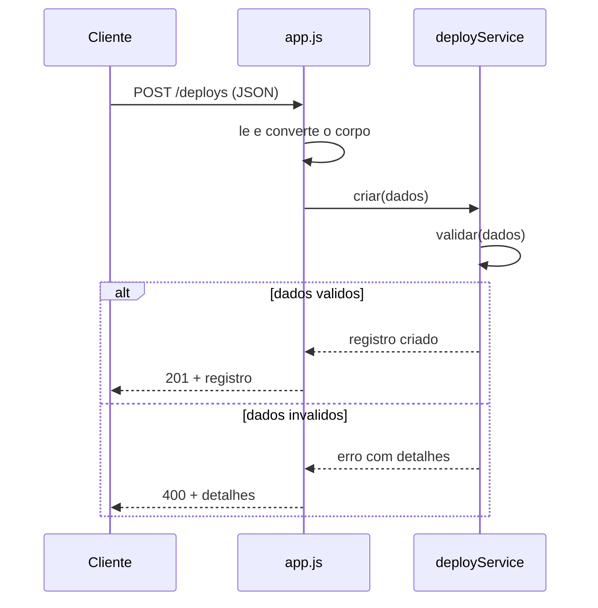

# Arquitetura

## Visao geral

| Camada | Arquivo | Responsabilidade |
|---|---|---|
| Entrada | `src/server.js` | Le a porta do ambiente e inicia o servidor |
| HTTP | `src/app.js` | Interpreta rota e metodo, le o corpo JSON, define o status HTTP |
| Regra de negocio | `src/deployService.js` | Valida dados, cria, lista, busca e remove registros |
| Armazenamento | Array em memoria | Guarda os registros enquanto o processo esta ativo |

A separacao entre `app.js` e `deployService.js` e o que permite testar as regras sem HTTP (unitario) e as rotas com HTTP (integracao).

## Fluxo de um POST /deploys

## Limitacoes conhecidas

| Limitacao | Impacto | Evolucao possivel |
|---|---|---|
| Armazenamento em memoria | Dados somem ao reiniciar | Banco SQLite ou PostgreSQL |
| Sem autenticacao | Qualquer cliente pode registrar ou remover | Token por servico |
| Sem paginacao | Lista cresce sem limite | Parametros `limit` e `offset` |
